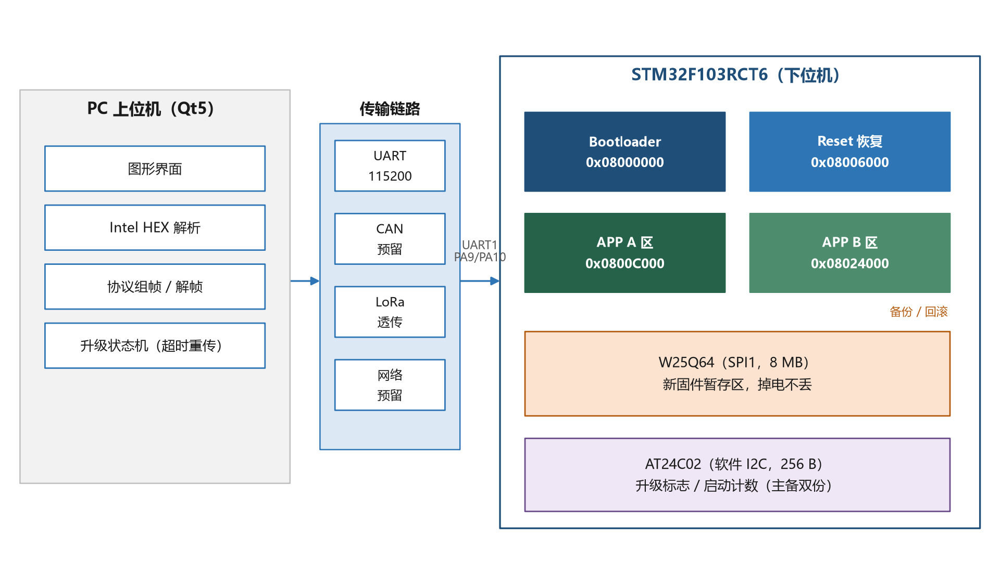
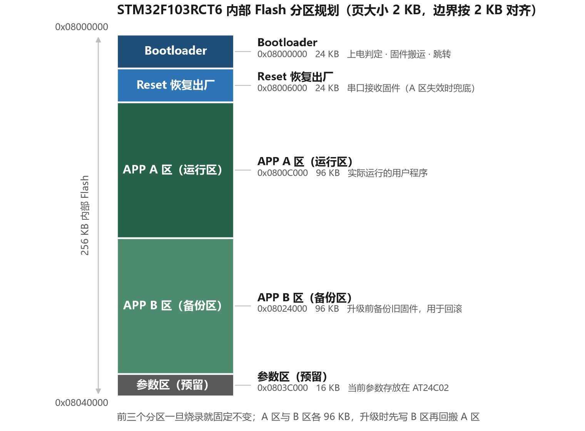
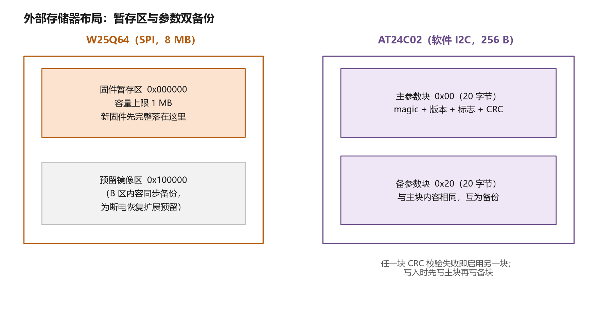
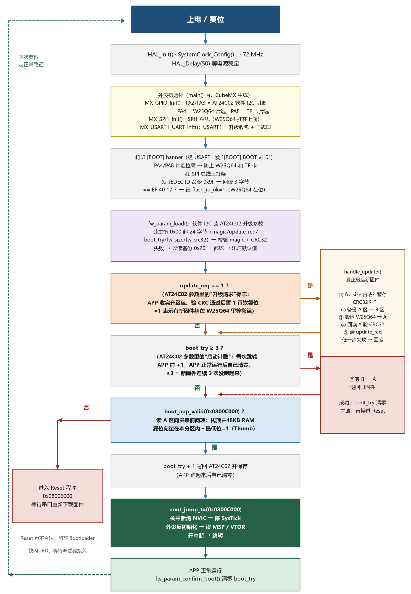
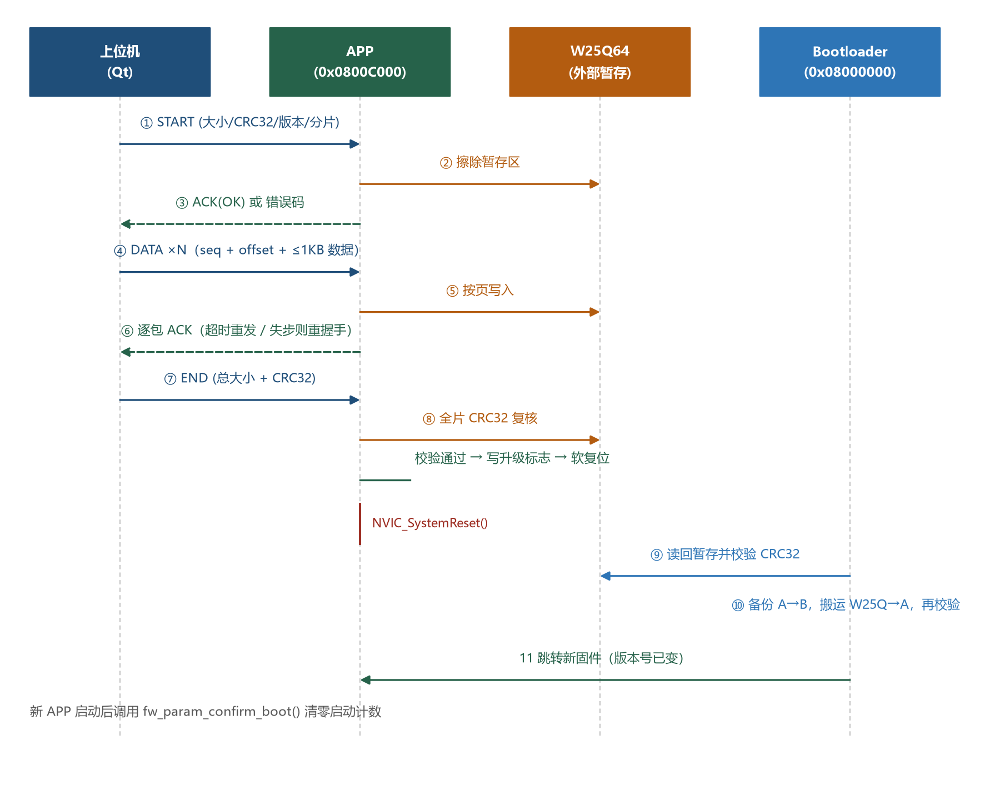
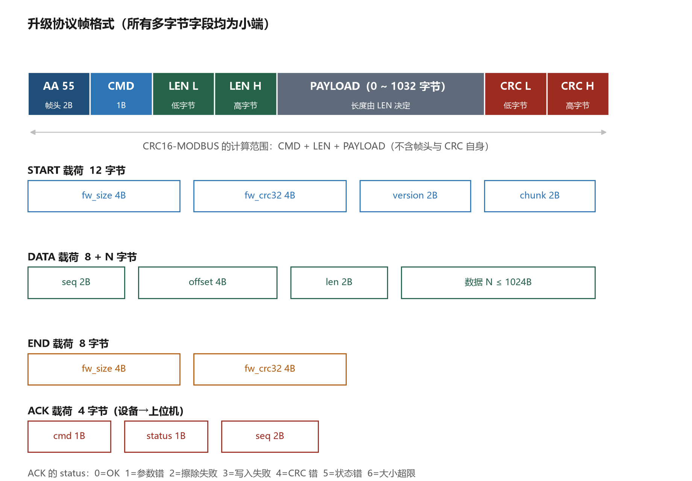
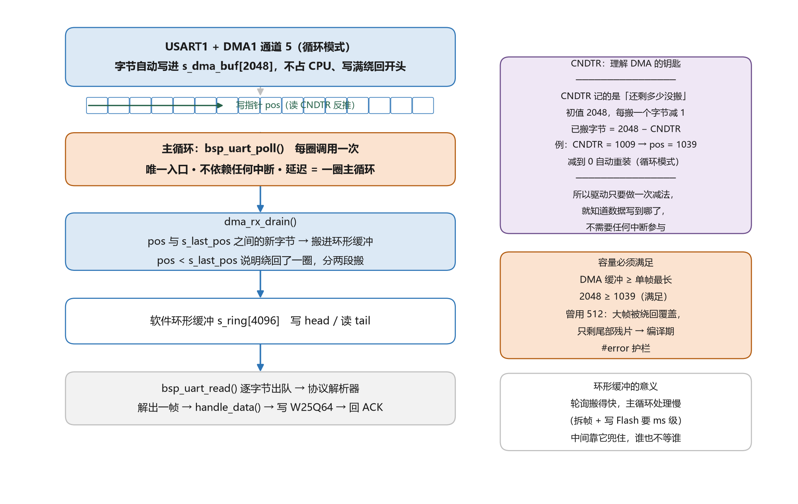

# STM32 固件升级系统 —— 原理与流程（精简版）

本项目在 STM32F103RCT6（野火 F103-MINI 开发板）上实现了一套完整的固件远程升级（IAP）系统：设备运行时通过串口接收新固件，先存入外部 SPI Flash 暂存，重启后由 Bootloader 校验并搬运到运行区，全程具备 CRC 校验、断电保护与失败回滚能力，做到"升级失败也不变砖"。

## 1. 背景：为什么需要它

产品一旦装进外壳、部署到现场（高处的采集终端、配电柜里的控制器），每次改一行代码都要拆壳、接线、拿 ST-Link 烧录，运维成本高到不可接受。**让设备自己通过网络或串口把新固件"吃"进去并完成自我更新**，就是这套系统要解决的问题——这个能力叫 **IAP**。

**IAP 和 OTA 不是一回事，面试常问：**

| | IAP（In-Application Programming） | OTA（Over-The-Air） |
| --- | --- | --- |
| 本质 | MCU 擦写**自身 Flash** ，改变自己的运行程序 | 一种**远程无线下发**固件的交付方式 |
| 关注点 | 怎么把新固件安全地写进自己 | 怎么把固件从云端送到设备 |
| 关系 | 是"能力" | 是"形态"，落地时必须依赖 IAP |

一句话：**OTA 解决"固件怎么到设备"，IAP 解决"设备怎么把自己刷了"**。本项目链路是串口 / CAN / LoRa，属于 IAP；当 LoRa/4G 接上云端服务器自动下发时，这套 IAP 就构成了 OTA 的落地端。

设计目标五条：免调试器升级、断电不变砖、失败能回滚、彻底坏了有兜底、换传输链路不用改协议。

## 2. 用到的资源，以及为什么非它不可

| 资源 | 规格 | 在本项目中的作用 |
| --- | --- | --- |
| STM32F103RCT6（野火 F103-MINI 板） | 256 KB Flash / 48 KB RAM / **页 2 KB** | 主控，内部 Flash 划分 5 个分区 |
| W25Q64 | 8 MB SPI Flash | **升级包暂存区**（中转仓） |
| AT24C02 | 256 B I2C EEPROM | **升级标志与启动计数** |
| CH340 | USB 转串口 | 与上位机通信（PA9/PA10） |
| PC 上位机 | Qt5 | 解析 hex、组帧、控制流程 |

**为什么必须要 W25Q64（关键设计）**

升级时最大的忌讳是"程序自己擦自己"：Flash 擦除期间 CPU 从同一块 Flash 取指会被硬停，而且擦除会连正在执行的代码一起抹掉，设备当场失联。所以正确做法是**先把整包固件收到一个安全的地方，校验通过后再重启、由 Bootloader 搬运**。这个地方就是 W25Q64：8 MB 容量远超 96 KB 的固件，掉电不丢，还能留存历史版本。内部 Flash 也划了 B 区做备份，但那是"搬运失败后的退路"，不能用来接包。

**为什么用 AT24C02 存标志，而不用内部 Flash**

升级标志和启动计数需要**频繁小改**（每次启动都要 +1 或清零）。内部 Flash 最小擦除单位是 2 KB，改 1 个字节也要擦一整页，且擦写寿命只有约 1 万次；AT24C02 支持**按字节写**，寿命约 100 万次，正好匹配这种"小、频、要掉电不丢"的数据。

**为什么"页大小 2 KB"值得单独记住**

它是分区的量子：所有分区边界都必须按 2 KB 对齐，否则擦除一个分区会连带擦掉邻居的头部，这是分区表设计的硬约束。

## 3. 系统设计

### 3.1 总体框图



三个程序 + 两颗外部芯片 + 一个上位机：

- **Bootloader**（0x08000000，24 KB）：上电第一段代码，只做三件事——判定该跑谁、搬运新固件、跳转
- **Reset 恢复出厂**（0x08006000，24 KB）：最后的救命稻草，A 区彻底损坏时进来，通过串口重新下载
- **APP A 区**（0x0800C000，96 KB）：真正的业务程序，运行期间兼职"接收升级包"
- **B 区**（0x08024000，96 KB）：升级前的旧固件备份，回滚用
- **W25Q64**：暂存新固件；**AT24C02**：存参数与标志

### 3.2 存储分布



前三个分区一旦烧录就固定；A/B 两区各 96 KB 互为备份；参数区预留但未使用（参数实际在 AT24C02）。



W25Q64 前 1 MB 作暂存区，够放 10 个 96 KB 固件；后半区预留做镜像同步。

### 3.3 启动流程：上电后 Bootloader 做什么

#### 3.3.1 先补一课：Cortex-M3 是怎么"开始运行"的

这段是整个项目的地基，不理解它就看不懂"跳转"到底在干什么。

**① 复位后 CPU 做的不是"从 main 开始"，而是三个硬件固定动作。** 上电或按复位键，CPU 内核不看任何代码，直接做：

1. 从地址 `0x08000000` 读 **4 字节**，装进 **MSP**（主栈指针）——之后所有函数调用、局部变量都用这块栈
2. 从 `0x08000004` 读 **4 字节**，作为**复位向量**，即第一句要执行指令的地址
3. 跳过去执行

注意是"读 4 字节当地址"，不是"执行那里的代码"。所以 Flash 开头这 8 个字节不是程序，是**两个数据**：栈顶初值 + 入口地址。这就是为什么**Bootloader 必须从 0x08000000 开始**——这是芯片硬性约定，改不了。

**② 这 8 个字节后面是一整张向量表，每项 4 字节：**

| 地址偏移 | 内容 | 说明 |
| --- | --- | --- |
| 0x00 | 初始栈顶值（如 0x20005000） | 指向 RAM 顶端往下，即栈的起点 |
| 0x04 | Reset_Handler 地址（如 0x080001C1） | 复位后执行的第一句 |
| 0x08 | NMI_Handler | 不可屏蔽中断 |
| 0x0C | HardFault_Handler | 硬件错误，跑飞了会进这里 |
| 0x10 ~ 0x3C | 其余系统异常 | SVC、PendSV、SysTick 等 |
| 0x40 起 | 各外设中断 | 串口、定时器、SPI、DMA…… |

CPU 遇到中断时，就用"中断号 × 4"当偏移去这张表里取地址跳过去。**所以向量表在哪，中断就去哪**——这是理解后面 VTOR 的关键。+++++

**③ 地址最低位为什么必须是 1（Thumb 位）。** Cortex-M 只支持 Thumb 指令集，函数地址的最低位不表示地址，而是"状态位"：为 1 表示这是 Thumb 代码。硬件跳转时会自动把最低位清零再去取指。所以编译器给函数指针赋的值总是奇数（如 0x080001C1），**如果你看到复位向量是偶数，说明它不是一个合法函数入口**——这正是校验里查最低位的原因。

**④ VTOR：告诉 CPU"向量表搬家了"。** 默认 VTOR=0，中断按 `0x00000000+偏移` 取向量（F103 上该区域被映射到 Flash 起始，即 Bootloader 的表）。APP 烧在 0x0800C000，它自己的向量表也在那里，所以跳转前必须写 `SCB->VTOR = 0x0800C000`。**忘了这一步，APP 里一开串口中断就会跳到 Bootloader 的处理函数，跑飞进 HardFault。**

**⑤ 于是"跳转到 APP"本质就是把开机那三个动作在 0x0800C000 重演一遍**：先检查那里的"栈顶+复位向量"像不像话（在 RAM 内、在本分区内、最低位为 1），再手动设 MSP、设 VTOR、跳到复位向量。

而中间那些"关中断、清 NVIC、停 SysTick、外设反初始化"是在给 APP 打扫房间：Bootloader 开着的串口中断、SysTick 在跳转后依然可能触发，中断入口却还是旧表里的地址，一进就崩。**尤其 PRIMASK 这个"关中断开关"不会随函数跳转自动恢复**——跳转前忘了开中断，APP 里所有中断将永远静默，串口收不到数据、定时器不走，现象极其难查（本项目第一版就栽在这）。

#### 3.3.2 Bootloader 的完整流程



整条链路可以概括成**三个阶段、三个问题、三级兜底**：

**阶段一：准备**——初始化时钟与外设（GPIO 含 AT24C02 的软件 I2C 引脚、SPI1、USART1），打印 banner 版本信息，读 W25Q64 的 JEDEC ID 确认芯片在位，再从 AT24C02 读出参数（主份→备份→默认值三级降级）。

**阶段二：判定，回答三个问题**

1. **有新固件要搬吗？**（`update_req == 1`）——APP 收完包后置的标志。要走就校验暂存固件 CRC32、备份 A 区到 B 区、搬运到 A 区、回读再验一次，任何一步失败都回滚。
2. **是不是反复跑不起来？**（`boot_try ≥ 3`）——每次跳转前计数 +1，APP 正常跑起来后自己清零。连续三次没人清零，说明新固件一跑就死，直接从 B 区退回旧版本。
3. **A 区固件能跑吗？**——检查向量表前两项：栈顶是否落在 48 KB RAM 内、复位向量是否在本分区内、最低位是否为 1（Thumb）。

**阶段三：跳转**——关中断清 NVIC、停 SysTick、外设反初始化、设 MSP 与 VTOR、重开中断、跳到复位向量。

**三级兜底**：A 区不合法 → 进 Reset 等串口重下；Reset 也坏 → 留在 Bootloader 快闪 LED 等调试器。任何一级活着，设备就不算死机。

### 3.4 一次完整升级的时序



关键点：**升级动作发生在 APP 里，生效动作发生在重启后**。APP 只负责把固件收进 W25Q64、校验、置标志、软复位；真正写内部 Flash 的是 Bootloader。这样即使传输中途断电、CRC 不符、数据错乱，A 区原固件毫发无损，设备重启后照常运行旧版本——这是"升级失败不变砖"的根基。

**为什么不让 Bootloader 自己收包？** 那样 Bootloader 里得塞进完整协议栈甚至文件传输协议，体积从 24 KB 涨到不可控；更致命的是收包失败时设备停在 Bootloader 里，没有任何可回退的固件，只能拆机。让业务程序收包，风险天然被隔离。

### 3.5 关键设计取舍

| 设计 | 为什么这么定 |
| --- | --- |
| 独立 Reset 分区 | Bootloader 尽可能小、逻辑简单；恢复出厂功能（含完整串口下载）单独放，坏了也不影响启动链 |
| A/B 双区而非原地覆盖 | 回滚需要一个"完整的旧版本"，原地覆盖就没有退路了 |
| 标志放 EEPROM、参数双份 | 频繁改写 + 掉电安全，双份 + CRC 抗单点损坏 |
| 协议与链路解耦 | 串口/CAN/LoRa 只换传输层，帧格式与状态机不动 |

### 3.6 扩展问题：BOOT 和 RESET 分区能这样一起升级吗？

**结论先行：APP 可以（已实测闭环）；RESET 原则上不建议在线升级；BOOT 技术上可行但要多一跳。** 三者的难度完全不同，原因在于"谁在执行搬运代码"：

| 目标分区 | 能否用当前流程直接升 | 核心障碍 |
| --- | --- | --- |
| APP（A 区） | **能** | 无——APP 收包、Bootloader 搬运，两者互不相干 |
| RESET | **协议支持即可，但不建议** | 它是最后的恢复手段，升坏了就失去兜底 |
| BOOT | **不能直接** | **Bootloader 不能擦除自己正在执行代码的那块 Flash** |

**为什么 Bootloader 不能升级自己？** Flash 控制器在擦写某一页时，该 Bank 的读取会被阻塞——而 Bootloader 的代码恰好就从那块 Flash 里取指执行，擦写的瞬间 CPU 连下一条指令都取不出来。这不是软件 bug，是 STM32 内部 Flash 的硬件特性（单 Bank）。所以"BOOT 升级自己"在逻辑上就绕不过去。

**正确的做法是"换人搬运"**——利用系统里已有的、不在被升级分区里运行的代码：

1. **升级 BOOT：让 RESET 程序当搬运工**。RESET 区（0x08006000）有完整的 Flash 驱动和启动判断逻辑，给它加一个分支："BOOT 升级标志 = 1 → 从 W25Q64 读新 BOOT → 擦写 0x08000000 起 24KB → 校验 → 清标志 → 复位"。BOOT 自己只负责收包入暂存区、置不同的标志号（target=BOOT）。链路变成：APP 收包 → 复位 → BOOT 看到 BOOT 升级请求 → **跳转到 RESET 区执行** → RESET 搬运 → 复位 → 新 BOOT 启动。
2. **升级 RESET：让 BOOT 当搬运工**，与升 APP 完全同构——BOOT 本来就在做"从 W25Q64 搬到内部 Flash"，只是目标地址换成 0x08006000、目标长度 24KB。

两者合起来其实是一个对称设计：**BOOT 和 RESET 互为对方的搬运工，互相都升级不了"当前正在运行的自己"**。

**需要在现有系统上改什么（工程量评估）：**

- **协议**：START 载荷加 1 字节 `target`（0=APP、1=RESET、2=BOOT），LEN 从 12 变 13；END 后设备置的标志里带 target
- **参数区**：`fw_param_t` 加 target 字段（AT24C02 的 24 字节还有富余）
- **BOOT**：搬运循环的目标地址/长度按 target 分派；target=BOOT 时跳 RESET 区执行（复位向量改为 0x08006000）
- **RESET**：新增 BOOT 搬运分支（复用已有的 flash_copy / CRC32）
- **上位机**：目标下拉框已支持 BOOT/RESET 选项，改协议层即可

**为什么当前版本没做？** 三个分区互相独立可升级是 v2 目标；v1 的优先级是把最常用的 APP 闭环做扎实。另外 RESET 不建议开放在线升级还有一个运维理由：恢复出厂通道的意义就在于"**永远有一个已知的、不被业务污染的入口**"——它一旦也变成可变的，最后的安全网就没了。真要升 RESET，更稳妥的做法是同时备份旧版本到 W25Q64，升级失败自动回滚（和 APP 的 A/B 机制同构）。

> 面试角度：这道题的正确打开方式是先说清"**代码不能从正在被擦写的 Flash 里执行**"这个硬件约束，再给"换人搬运"的方案，最后补充"恢复分区应保持不变"的运维视角——三层都答到才是完整答案。

## 4. 升级协议



### 4.1 帧结构与长度上限

**帧结构**：`AA 55 | CMD | LEN(2B) | PAYLOAD | CRC16(2B)`，全小端。帧头负责在字节流里找到起点，LEN 界定载荷长度，CRC16 逐帧校验（只覆盖 CMD+LEN+PAYLOAD）。

**一包到底能装多少？** 固定开销 7 字节（帧头 2 + 命令 1 + 长度 2 + CRC 2），所以：

- **LEN 的合法范围是 0 ~ 1032**（1032 = 1024 数据 + 8 字节 DATA 头），超了直接判 `BAD_LEN` 丢帧——这是解析器的硬门槛
- **整帧最大 1039 字节**（1032 + 7）
- 对 **DATA 命令**来说，载荷是"8 字节头 + 数据"，所以实际 LEN 是 **9 ~ 1032**；**1032 只会出现在"1024 字节数据 + 8 字节头"这一种情况**，正好顶到上限。START 的 LEN 固定 12、END 固定 8、ACK 固定 4，都远小于它

### 4.2 三条命令的载荷构成

| 命令 | LEN | 载荷内容（字节数） | 作用 |
| --- | --- | --- | --- |
| START (0x01) | 12 | 固件总大小(4) + 整包 CRC32(4) + 版本号(2) + 分片长度(2) | 握手；设备校验参数、擦除暂存区、回就绪 |
| DATA (0x02) | 9 ~ 1032 | 包序号(2) + 偏移(4) + 本包长度(2) + 数据(1 ~ 1024) | 逐包传输，每包必须应答 |
| END (0x03) | 8 | 总大小(4) + 整包 CRC32(4) | 收尾；设备整包复核后置标志、软复位 |
| ACK (0x81) | 4 | 被应答命令(1) + 状态码(1) + 序号(2) | 上位机据此决定继续 / 重发 / 报错 |

状态码：0 成功、1 参数错、2 擦除失败、3 写入失败、4 CRC 错、5 状态机越界、6 尺寸超限。

### 4.3 为什么分片定 1024 字节

不是随手取值，四个约束交叉出来的结果：

1. **对 W25Q64 友好**：页大小 256 字节，1024 = 整 4 页，写入不用处理跨页拆分
2. **对 RAM 友好**：F103 只有 48 KB RAM，接收缓冲要能装下**一整帧**（1039 字节），取 2048 刚好有富余
3. **对吞吐友好**：115200 波特率理论约 11.5 KB/s，1 KB 一包 + 一个 ACK 往返，96 KB 固件约十几秒；再小（如 128 B）帧数翻 8 倍，ACK 往返把时间全吃掉
4. **对链路友好**：CAN 单帧只有 8 字节数据，1 KB 需拆 128 帧以上，再大就更难拆；LoRa 单包也有几十字节上限，1024 是可以接受的折中

**为什么不能"一包把整个固件发完"**：单帧长度字段只有 2 字节（上限 65535），96 KB 装不下；而且任何 1 位错误都要重传整包，RAM 也放不下。分包是必然选择。

### 4.4 一次完整升级的报文示例

场景：升级一个 **1040 字节**（0x0410）的固件，整包 CRC32 = 0x3F2A7C19，版本 v1.4（0x0104），分片 1024 字节。所以是 2 包数据：第 0 包 1024 字节、第 1 包 16 字节。

**① 上位机 → 设备：START**

```text
AA 55 01 0C 00 | 10 04 00 00 | 19 7C 2A 3F | 04 01 | 00 04 | 67 21
帧头  命令 长度=12  总大小1040   整包CRC32    版本v1.4  分片1024   CRC16
```

**② 设备 → 上位机：ACK（成功）**

```text
AA 55 81 04 00 | 01 00 00 00 | 8A 70
帧头  应答 长度=4  应答START  状态0=OK  序号0    CRC16
```

设备收到后擦除 W25Q64 暂存区，回这一帧；上位机见到状态 0 才开始发数据。

**③ 上位机 → 设备：DATA 第 0 包（1024 字节，正文省略）**

```text
AA 55 02 08 04 | 00 00 | 00 00 00 00 | 00 04 | …… 1024 字节固件数据 …… | ×× ××
帧头  命令 长度=1032  序号0    偏移0        长度1024                     CRC16
```

注意 LEN = 0x0408 = 1032，正好等于上限——这就是"1032"唯一会出现的场合。

**④ 设备 → 上位机：ACK 第 0 包；然后循环发第 1 包（16 字节，末包短）**

```text
AA 55 02 18 00 | 01 00 | 00 04 00 00 | 10 00 | 00 01 02 03 04 05 06 07 08 09 0A 0B 0C 0D 0E 0F | D0 EF
帧头  命令 长度=24  序号1    偏移1024     长度16   本包 16 字节数据                               CRC16
```

```text
AA 55 81 04 00 | 02 00 01 00 | 8B A4      ← 设备应答第 1 包：命令02、状态0、序号1
```

**⑤ 上位机 → 设备：END**

```text
AA 55 03 08 00 | 10 04 00 00 | 19 7C 2A 3F | 55 72
帧头  命令 长度=8   总大小1040   整包CRC32    CRC16
```

**⑥ 设备复核整包 CRC32**：一致则回 ACK（状态 0），把 `update_req=1`、`fw_size`、`fw_crc32` 写进 AT24C02，软复位；不一致回 ACK（状态 4 = CRC 错），上位机重传。

```text
AA 55 81 04 00 | 03 00 00 00 | 8B C8      ← 设备应答 END
```

**⑦ 复位后**：Bootloader 看到 `update_req=1`，从 W25Q64 读回 1040 字节再算一次 CRC32，与参数里的一致 → 备份 A 区 → 搬运 → 回读校验 → 跳转新固件。上位机此时会看到版本号从旧值变成 v1.4。

### 4.5 两条可靠性机制

- **停等协议**：发一包等一个 ACK，超时重发；连续失败或解析器失步就**重新 START 握手**（防止半帧错位后陷入死循环）
- **三次 CRC32**：收包结束时验一次（数据在 W25Q64 里对不对）、Bootloader 搬运前再验一次（暂存区等待重启期间有没有被写坏）、搬完回读 A 区验第三次（写进内部 Flash 的到底对不对）

## 5. 注意点与面试高频考点

**五个真实踩过的坑**

1. **跳转前忘记开中断**：`__disable_irq()` 设置的 PRIMASK 不会因函数跳转而恢复，APP 里所有中断永远静默——现象极诡异，串口收不到、定时器不跑。
2. **DMA 接收缓冲小于单帧长度**：循环 DMA 会绕回覆盖，轮询时只捞到尾部残片，表现为"偶尔能收、经常超时"。缓冲必须 ≥ 最大帧长。
3. **两片 SPI 设备共用总线**：W25Q64 和 TF 卡片选同时拉低会在 MISO 上打架，读 ID 得到 0xFFFFFF。上电先把两路片选都拉高。
4. **APP 工程忘了改 IROM 起始地址**：链接到 0x08000000 的 APP 烧到 0x0800C000 必然跑飞。
5. **整片擦除烧录**：Bootloader 和 APP 分三次烧、每次都整片擦，后烧的会把先烧的抹掉——要用合并 hex 一次烧。

**必须能讲清的原理题**

- Cortex-M3 复位后做了什么？（读 MSP、读复位向量、跳转）跳转 APP 本质是把这三件事在 0x0800C000 重演。
- 跳转前为什么要关中断、清 NVIC、停 SysTick、设 VTOR？（旧中断/旧定时器会打进新程序；VTOR 决定中断去哪张向量表找入口）
- 如何保证升级失败不彻底死机？（APP 收包 + 外部暂存 + CRC 三重校验 + A/B 备份 + 启动计数回滚 + Reset 兜底）
- CRC16 和 CRC32 各自用在哪、为什么不能互换？（CRC16 管单帧完整性，实时性优先；CRC32 管整包一致性，要拦得住极低概率的碰撞）
- 一帧最大多少字节？分片为什么取 1024？（1039 字节；整 4 页 W25Q64、装得进 RAM、ACK 开销与 CAN/LoRa 拆帧的综合折中）
- 为什么标志位存 EEPROM？（擦写粒度、寿命、掉电保持）为什么参数要存双份 + 自校验？
- Bootloader 为什么定 24 KB？（HAL 库 + 串口 + SPI + 软件 I2C 的实测体积，留足余量且不浪费）
- 升级过程中断电，设备下次上电能恢复到什么状态？（取决于断电发生在收包中 / 置标志后 / 搬运中，三种情况分别说明）
- Bootloader 能不能升级它自己？为什么？（不能——单 Bank Flash 擦写时会阻塞取指；方案：换不在被擦区运行的代码当搬运工，见 3.6）
- 收一帧 1039 字节，CPU 要进多少次中断？（0 次——DMA 循环写入，主循环轮询搬运，全程无中断参与。追问"为什么不用中断通知"，答案在《项目难点与解决方案》）

## 6. 底层驱动详解：串口+DMA 接收与两颗存储芯片

这一章把数据的"进"（串口接收）和"存"（两颗芯片的读写）讲透，代码均为工程真实源码的关键步骤节选。

### 6.0 先总览：这一章涉及哪些技术

整个升级链路本质是一条"字节搬运流水线"，每一段用不同的硬件外设，各自的瓶颈和写法完全不同：

| 环节 | 用到的技术 | 一句话说清为什么 | 详见 |
| --- | --- | --- | --- |
| 字节进芯片 | USART1 + DMA1 循环模式 | 一个字节一次中断撑不住 1039 字节的大帧，交给 DMA 搬 | 6.1 |
| 字节到内存 | 主循环轮询 + 环形缓冲 | 不依赖中断触发时机，两级缓冲解耦"搬得快"和"处理慢" | 6.1 |
| 字节解析 | 状态机 + CRC16 校验 | 从连续字节流里切出帧，逐帧验完整性 | 第 4 章 |
| 固件暂存 | W25Q64（SPI NOR Flash） | 内部 Flash 不能自己擦自己，必须外部暂存 | 6.2 |
| 固件落地 | 内部 Flash 编程（页/扇区） | 只能按页写、按扇区擦，且代码不能从正在擦写的区执行 | 3.6 |
| 升级记账 | AT24C02（I2C EEPROM） | 按字节写、掉电不丢、寿命 100 万次，适合频繁改的标志位 | 6.3 |
| 整包校验 | CRC32 | 拦得住极低概率的数据碰撞，比累加和可靠 | 4.5 |

一条链路串起来：**数据从 USART1+DMA 进来 → 解析成包 → 写进 W25Q64 → 账记在 AT24C02 → 复位后 Bootloader 照账搬运到内部 Flash**。

下面按"进 → 存 → 记"的顺序逐个讲。先讲串口，因为它是整条链路里唯一需要和"时间"打交道的地方（字节不等人，来慢了就丢）。

### 6.1 串口接收：DMA 循环 + 主循环轮询 + 环形缓冲



**要解决的问题**：115200 波特率下每 87 µs 到一个字节，一帧最长 1039 字节。如果用"一个字节一次中断"，收一帧就要进 1039 次中断，CPU 大部分时间在保存/恢复现场，协议解析和 Flash 写入被切得粉碎。

**方案**：让 DMA 负责"搬字节"（硬件干），让主循环负责"取字节"（软件干），中间用环形缓冲解耦。整条链路**没有中断参与**，分四层：

1. **硬件层**：DMA1 通道 5 以**循环模式**把收到的字节写进 `s_dma_buf[2048]`，写满自动绕回开头——像一个不停转动的传送带；
2. **搬运层**：主循环每圈调用一次 `bsp_uart_poll()`，读 DMA 剩余计数 `CNDTR` 反推写指针 `pos`，把 `pos` 与上次位置 `s_last_pos` 之间的新字节搬进软件环形缓冲；
3. **缓冲层**：软件环形缓冲 `s_ring[4096]`，写指针 head、读指针 tail；
4. **消费层**：主循环 `bsp_uart_read()` 逐字节出队，喂给协议解析器。

全部核心代码就三段：

```c
/* platform/bsp_uart_dma.c */

void bsp_uart_rx_start(UART_HandleTypeDef *huart)
{
    /* 启动 DMA 循环接收；数据什么时候被取走由主循环决定 */
    HAL_UART_Receive_DMA(huart, s_dma_buf, UART_RX_DMA_SIZE);
}

void bsp_uart_poll(void)        /* 主循环每圈调用一次，唯一的搬运入口 */
{
    dma_rx_drain();
}

static void dma_rx_drain(void)
{
    pos = (uint16_t)(UART_RX_DMA_SIZE - __HAL_DMA_GET_COUNTER(huart->hdmarx)); /* 反推写指针 */
    if (pos == s_last_pos) return;              /* 没有新数据 */

    if (pos > s_last_pos) {
        ring_push(&s_dma_buf[s_last_pos], pos - s_last_pos);              /* 正常推进 */
    } else {
        ring_push(&s_dma_buf[s_last_pos], UART_RX_DMA_SIZE - s_last_pos); /* 回卷：先收尾 */
        ring_push(&s_dma_buf[0], pos);                                    /* 再从头收 */
    }
    s_last_pos = pos;
}
```

#### 6.1.1 先科普：DMA 到底是什么

**CPU 搬一个字节有多麻烦**：要从外设数据寄存器读出来放进临时变量，再算目的地址，再写进内存，再把指针加一，再判断搬够没有。真正搬数据只有两条指令，其余全是"管理开销"。字节来得越密，这个开销占比越高。

**DMA（Direct Memory Access，直接存储器访问）就是把这个活儿外包**。CPU 只需要给它填一张"任务单"，剩下它自己干：

| 寄存器 | 作用 | 在本项目里是 |
| --- | --- | --- |
| `CPAR` | 外设地址 | `&USART1->DR`（数据寄存器） |
| `CMAR` | 内存地址 | `s_dma_buf` 数组首地址 |
| `CNDTR` | 还要搬多少个 | 初始 2048，每搬一个减 1 |
| `CCR` | 怎么搬：方向、地址是否自增、数据宽度、是否循环、优先级、是否开中断 | 外设→内存、内存地址自增、8 位、循环模式 |

填完之后置 `CCR.EN=1`，DMA 就开始工作：USART1 每收到一个字节，硬件直接把它从 `DR` 搬到 SRAM，**不取指、不译码、不进中断**。这就是"不占 CPU"的真实含义——不是魔法，是把"逐字节的搬运指令"省掉了。

**为什么快**：数据走的是 AHB/APB 总线，DMA 是总线上的一个主设备，和外设直接对话。代价是它和 CPU **共享总线**，搬数据时会"偷"走几个总线周期（bus stealing），但每次只占几个周期，对本项目这种低速串口几乎无感。

**CNDTR 递减是理解一切的关键**：它记的是"还剩多少没搬"，从初值一路减到 0。所以

```
已经搬进缓冲的字节数 = 初值 − CNDTR
                    pos = 2048 − CNDTR
```

例：`CNDTR = 1009` → `pos = 1039`，说明这一帧 1039 字节刚好全部搬完。**这个"减法反推"就是所有 DMA 接收驱动的核心技巧**，记住它就够了。

#### 6.1.2 本项目的两个关键选择：循环模式 + 轮询取数

**① 循环模式（Circular）而不是普通模式（Normal）**

- 普通模式：搬满 CNDTR 就停，`EN` 自动清零，想再收必须软件重新启动一次。串口是连续字节流，一停就丢数据。
- 循环模式：CNDTR 减到 0 自动重装回初值，地址指针也回到起点，**永不停止**。代价是它会覆盖老数据——所以必须保证"在被覆盖之前把数据取走"。

**② 用主循环轮询取数，而不是等中断通知**

DMA 的"传输完成中断"只在**搬满整个缓冲**时才触发（这里是 2048 字节），而我们的帧只有 1039 字节，永远等不到。另一种常见做法是让 UART 在总线静默时产生"帧结束"中断来自动通知，本工程试过后放弃了——中断可能不触发，一旦不触发整帧就滞留在缓冲里，故障过程见《项目难点与解决方案》第 8 条。

改成主循环轮询后：主循环本来就每圈只花几十微秒，多读一次 `CNDTR` 的成本可以忽略；数据从到达到被搬走的延迟从最坏 2.4 秒降到一圈主循环（µs 级），而且**只要主循环活着，数据就一定被搬走**——不依赖任何中断触发条件。

> 这是一条通用的工程判断：**中断是"事件通知"，快但可能漏；轮询是"状态查询"，慢不了多少但必然执行**。对停等协议这种每包本来就要等 ACK 的场景，轮询的延迟完全可以忽略，可靠性却高一个量级。

#### 6.1.3 为什么还要一层软件环形缓冲

DMA 缓冲和环形缓冲是两级，职责不同：

- **DMA 缓冲（2048）**：硬件在写，CPU 只能"偷看"它的写指针，不能阻止它覆盖。它是**流水线的传送带**。
- **环形缓冲（4096）**：CPU 自己管，`dma_rx_drain()` 搬进来、`bsp_uart_read()` 取出去，两边各有读写指针，互不等待。它是**仓库**。

为什么要仓库？因为"搬"很快（微秒级，只是内存复制），"处理"很慢（拆帧、算 CRC16、写 W25Q64 要毫秒级）。如果没有中间缓冲，处理一包的时间里新来的字节就会被 DMA 覆盖掉。写满时选择丢弃并让上位机超时重发（停等协议天然支持），比阻塞 DMA 或无限扩容更务实。

#### 6.1.4 一条编译期护栏：缓冲必须装得下一整帧

轮询是"事后查看"，所以 DMA 循环缓冲必须容得下完整一帧——否则等你去搬的时候，前半部分已经被绕回的后半部分覆盖，只剩尾部残片。这个约束写成了编译期断言，改参数时不会忘：

```c
#if (FW_FRAME_MAX_LEN > UART_RX_DMA_SIZE)
#error "UART_RX_DMA_SIZE must be >= FW_FRAME_MAX_LEN, otherwise large frames get corrupted"
#endif
```

### 6.2 W25Q64：SPI NOR Flash 的读写

**特点**（这几个特性决定了驱动怎么写）：

- **命令式访问**：所有操作都是"拉低片选 → 发命令 + 24 位地址 →（读/发数据）→ 拉高片选"，没有传统内存的总线式寻址
- **读很自由**：`0x03` 读命令给出地址后可以连续读任意长度，跨页、跨扇区都不用管
- **写只能"把 1 改成 0"**：Flash 物理上只能把位从 1 写成 0。所以写入前**必须先擦除**（把整块全变回 1），且**编程按页进行，一页 256 字节，不能跨页**——地址如果从页中间写到底再继续，芯片会**回卷覆盖本页开头**
- **擦除按块进行**：最小扇区 4 KB（一擦全变 0xFF），典型耗时 45~400 ms
- **写使能与忙标志**：每条写/擦命令前必须先发 `0x06`（Write Enable），之后轮询状态寄存器 bit0（BUSY）等它做完

**识别芯片**：发 `0x9F`（JEDEC ID）回读 3 字节，W25Q64 是 `EF 40 17`——这就是 Bootloader 开机自检做的事。

**写数据的关键步骤**（注意跨页拆分）：

```c
/* platform/bsp_w25q64.c —— w25q_write_no_erase() 关键步骤 */
while (done < len) {
    /* 1. 算出本页还剩多少空间，本次最多写到页尾 */
    uint32_t page_left = W25Q_PAGE_SIZE - ((addr + done) % W25Q_PAGE_SIZE);
    uint32_t n = MIN(len - done, page_left);

    w25q_write_enable();                       /* 2. 写使能 0x06 */
    s_txbuf[0] = W25Q_CMD_PAGE_PROGRAM;        /* 3. 命令 0x02 + 24位地址 */
    s_txbuf[1] = (addr + done) >> 16;
    s_txbuf[2] = (addr + done) >> 8;
    s_txbuf[3] = (addr + done);
    memcpy(&s_txbuf[4], &buf[done], n);        /*    最多 256 字节数据 */

    W25Q_CS_LOW();
    HAL_SPI_Transmit(&W25Q_SPI, s_txbuf, n + 4, W25Q_TIMEOUT_MS);
    W25Q_CS_HIGH();

    w25q_wait_busy(100);                       /* 4. 等待内部编程完成（轮询 BUSY 位）*/
    done += n;
}
```

**擦除的关键步骤**（把 0xFF 还回来）：

```c
/* w25q_erase_region() 关键步骤：按 4KB 扇区逐个擦 */
for (s = 起始扇区; s < 结束; s += W25Q_SECTOR_SIZE) {
    w25q_write_enable();                       /* 擦除也要先写使能 */
    cmd = { 0x20, s>>16, s>>8, s };            /* Sector Erase + 24位地址 */
    W25Q_CS_LOW();  HAL_SPI_Transmit(&W25Q_SPI, cmd, 4, ...);  W25Q_CS_HIGH();
    w25q_wait_busy(500);                       /* 擦除较慢，给足超时 */
}
```

**读数据**最简单：`0x03 + 24 位地址` 后直接连续收，无需等待：

```c
/* w25q_read() 关键步骤：按页循环读，避免单次传输过长 */
hdr = { 0x03, addr>>16, addr>>8, addr };
W25Q_CS_LOW();
HAL_SPI_Transmit(&W25Q_SPI, hdr, 4, ...);      /* 发命令+地址 */
HAL_SPI_Receive(&W25Q_SPI, buf, n, ...);       /* 连续收 n 字节 */
W25Q_CS_HIGH();
```

**升级链路里的用法**正好贴合它的特性：升级全程对暂存区是"**先整块擦一次 → 顺序追加写 → 最后整体读回校验**"，没有随机改写——NOR Flash 最擅长这种模式。

**共总线注意**：野火板上 W25Q64（PA4 片选）和 TF 卡（PA8 片选）共用 SPI1，任何时刻只允许一个片选为低，所以上电第一步就是把两路片选都拉高，否则读 ID 得到 0xFFFFFF。

### 6.3 AT24C02：I2C EEPROM 的读写

**特点**：

- 容量只有 **256 字节**，却支持**按字节写**、擦写寿命 100 万次——这就是它放标志位的原因
- **页写 8 字节，跨页同样回卷覆盖本页开头**（跟 W25Q64 一个道理，页更小）
- 每次写完芯片内部要 **5 ms 左右的写周期**（tWR），期间不响应任何操作，必须延时等待
- I2C 器件地址 **0xA0**（写）/ 0xA1（读）
- 板上接在 PA2/PA3——F103 的硬件 I2C1 只能映射到 PB6/PB7 或 PB8/PB9，**所以只能用 GPIO 软件模拟 I2C**（不看原理图必踩的坑）

**GPIO 初始化**：两根线都配成**开漏输出**（I2C 总线要求线与，谁都能拉低、靠上拉电阻回高）：

```c
/* demo_boot/Core/Src/gpio.c（CubeMX 生成） */
GPIO_InitStruct.Pin   = GPIO_PIN_2 | GPIO_PIN_3;      /* SCL=PA2, SDA=PA3 */
GPIO_InitStruct.Mode  = GPIO_MODE_OUTPUT_OD;          /* 开漏，配合外部上拉 */
HAL_GPIO_Init(GPIOA, &GPIO_InitStruct);
```

**读数据的关键步骤**——I2C 组合协议"写地址 + 重复起始 + 读数据"：

```c
/* platform/bsp_at24c02.c —— at24c02_read() 关键步骤 */
i2c_start();
i2c_write_byte(0xA0);              /* 1. 器件地址(写方向)，等 ACK */
i2c_write_byte(mem_addr);          /* 2. 想读的存储单元地址 */

i2c_start();                       /* 3. 重复起始（不改方向没法读）*/
i2c_write_byte(0xA1);              /*    器件地址(读方向) */

for (i = 0; i < len; i++)
    buf[i] = i2c_read_byte(i + 1 < len);  /* 4. 连续读；最后一字节回 NACK */

i2c_stop();
```

**写数据的关键步骤**——按 8 字节页拆分 + 写后延时：

```c
/* at24c02_write() 关键步骤 */
while (done < len) {
    uint16_t page_left = AT24C02_PAGE_SIZE - ((mem_addr + done) % AT24C02_PAGE_SIZE);
    uint16_t n = MIN(len - done, page_left);   /* 跨页必须拆开，否则回卷覆盖本页开头 */

    i2c_start();
    i2c_write_byte(0xA0);                      /* 器件地址(写) */
    i2c_write_byte(mem_addr + done);           /* 目标单元地址 */
    for (i = 0; i < n; i++)
        i2c_write_byte(buf[done + i]);         /* 逐字节发数据，每个等 ACK */
    i2c_stop();

    HAL_Delay(6);                              /* tWR 写周期，手册典型 5ms，留余量 */
    done += n;
}
```

**软件 I2C 的时序本质**：`i2c_write_byte()` 就是把一个字节的 8 个位逐个搬上线——SCL 拉低时改变 SDA，SCL 拉高时对方采样；第 9 个时钟释放 SDA 读对方的 ACK。用 `i2c_delay()`（几十个空转周期，约 2~3 µs）把速率控制在 100~200 kHz。慢是慢了点，但 24 字节参数读写毫秒级完成，完全够用。

### 6.4 三者对比与分工

| | USART1 + DMA | W25Q64 | AT24C02 |
| --- | --- | --- | --- |
| 接口 | UART（异步串行） | SPI（同步串行） | I2C（软件模拟） |
| 容量 | —（数据通道） | 8 MB | 256 B |
| 写入粒度 | 字节流 | 页 256 B（先擦后写） | 页 8 B（无需擦除） |
| 擦除 | 无 | 扇区 4 KB | 不需要 |
| 擦写寿命 | — | 约 10 万次 | 约 100 万次 |
| 在升级中的角色 | **数据入口**：收上位机的帧 | **暂存仓库**：整包固件先放这 | **账本**：升级标志、大小、CRC、启动计数 |

一句话串起来：**数据从 USART1+DMA 进来 → 解析校验后顺序写进 W25Q64 → 收完把"账"记在 AT24C02 → 复位后 Bootloader 照着账本把 W25Q64 里的固件搬进内部 Flash。** 三种外设、三种接口、三种特性，各司其职。
