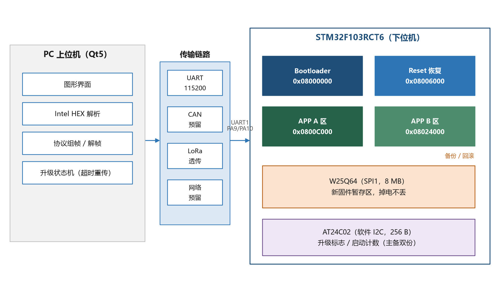
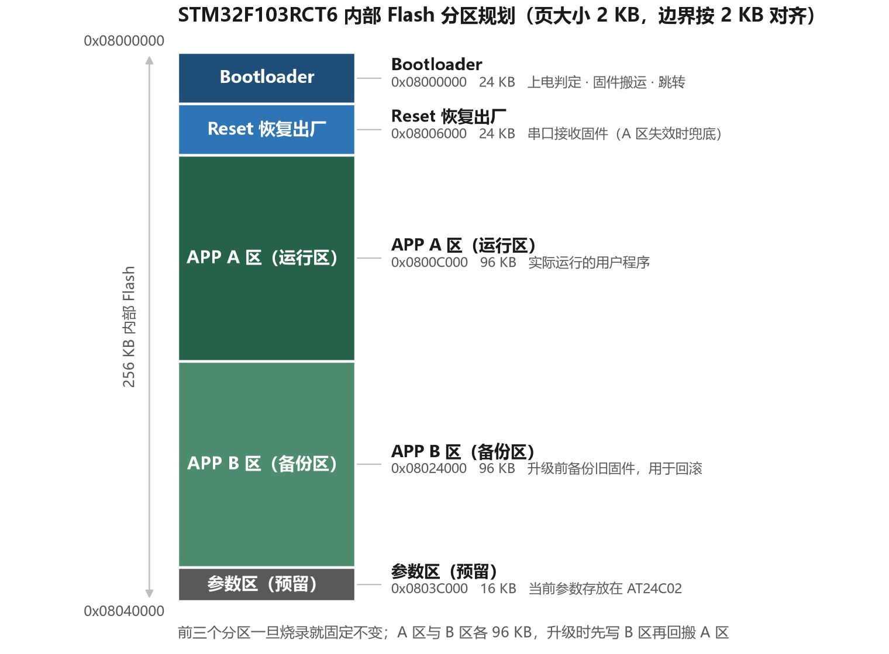
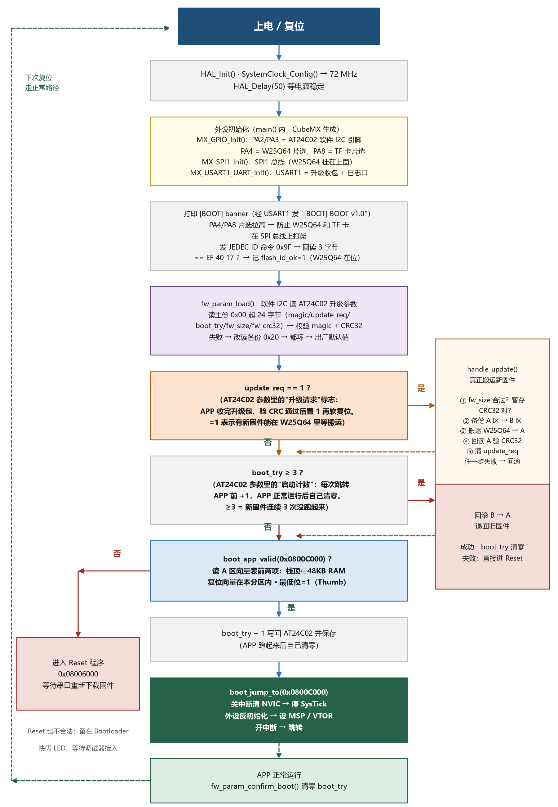
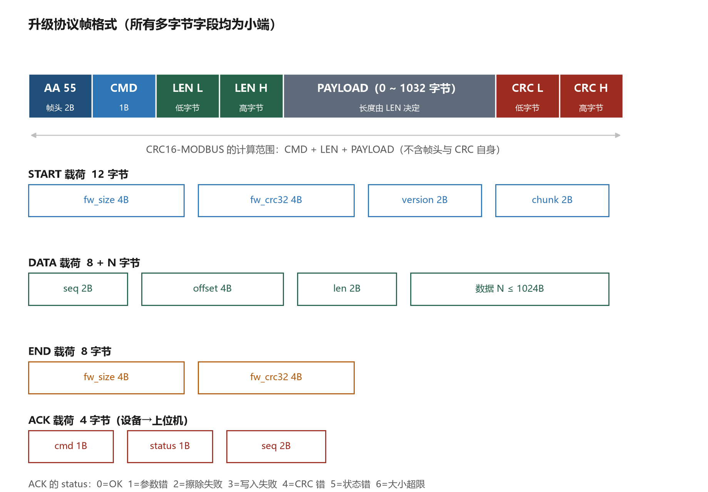
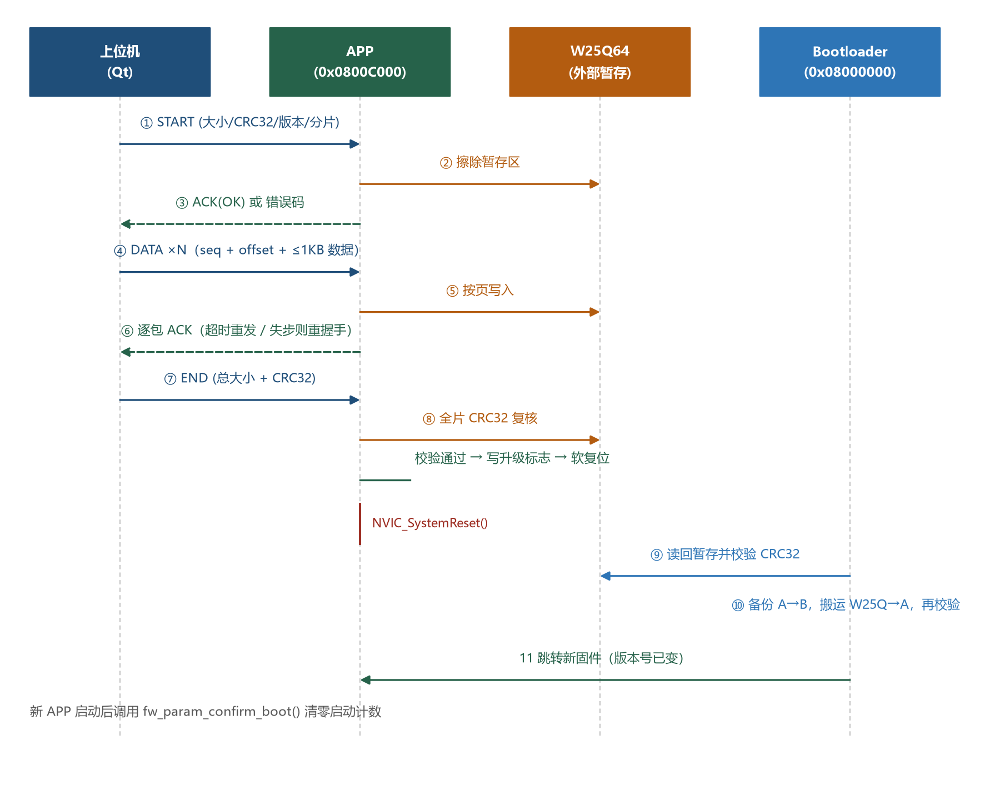
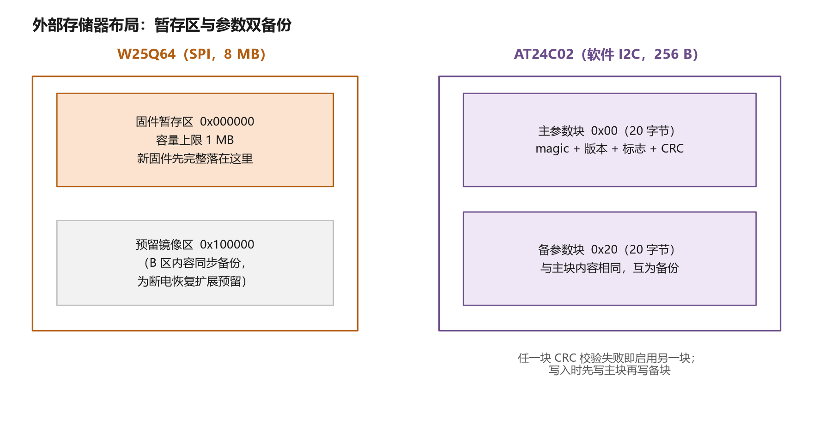
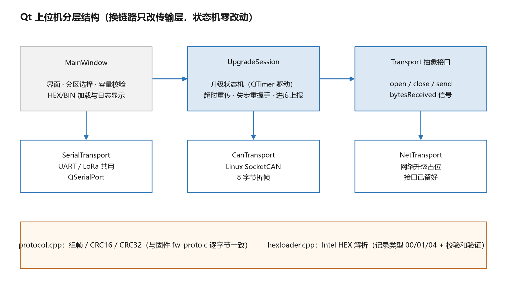

# 基于 STM32 的 Bootloader 与固件升级系统 — 设计与实现文档

## TL;DR

本项目在 STM32F103RCT6（野火 F103-MINI 开发板）上实现了一套完整的固件远程升级（IAP）系统：设备运行时通过串口接收新固件，先存入外部 SPI Flash 暂存，重启后由 Bootloader 校验并搬运到运行区，全程具备 CRC 校验、断电保护与失败回滚能力，做到"升级失败也不变砖"。配套 Qt 上位机支持 UART / CAN / LoRa 多链路升级。

**元信息**

- 目标读者：有 STM32 基础（会用 GPIO/UART/HAL 库），但没做过 IAP/Bootloader 的开发者
- 前置知识：Cortex-M3 启动流程（本文 4.1 会补）、Keil/CubeMX 基本使用、C 语言指针与内存映射
- 技术栈：STM32F103RCT6（256 KB Flash / 48 KB RAM / 2 KB 页）、HAL 库、W25Q64、AT24C02、Qt 5.9
- 正文约 40 分钟阅读量；代码均来自本项目真实源码，可直接对照工程阅读

## 1. 项目背景与目标

### 1.1 要解决的问题

STM32 程序通常用调试器（ST-Link/J-Link）烧录。但对一台已经装进外壳、部署在现场的设备——比如一个挂在高处的采集终端——每次改一行代码都要拆壳接线，运维成本极高。

IAP（In-Application Programming，在应用编程）解决的就是这个问题：**让设备在正常运行状态下，通过自身的通信接口（串口、CAN、LoRa、4G 等）接收新固件并完成自我更新**，全程不需要调试器。

### 1.2 设计目标

| 目标 | 具体含义 |
| --- | --- |
| 免调试器升级 | 串口发一个 bin 文件即可完成升级 |
| 断电安全 | 升级中途断电，设备仍能用旧固件启动 |
| 失败回滚 | 新固件反复启动失败，自动退回旧固件 |
| 兜底恢复 | 就算 Flash 被写坏，还有恢复出厂程序救回来 |
| 链路无关 | 协议层不绑定传输方式，串口/CAN/LoRa 通用 |

### 1.3 硬件平台

野火 F103-MINI 开发板，主控 STM32F103RCT6（高密度型）：

- 内部 Flash 256 KB，**页大小 2 KB**（擦除最小单位，后面分区全按它对齐）
- SRAM 48 KB（0x20000000 ~ 0x2000C000）
- 板载 W25Q64（SPI 接口 8 MB Flash）、AT24C02（I2C 接口 256 字节 EEPROM）、CH340 USB 转串口

一个关键事实：这块板的 AT24C02 接在 **PA2/PA3**，而 STM32F1 的硬件 I2C1 只能映射到 PB6/PB7 或 PB8/PB9——所以 EEPROM 必须用 **GPIO 软件模拟 I2C**（详见 8.3 节）。这是不看原理图就会踩的坑。

## 2. 系统总体设计



整个系统由"三个程序 + 两颗外部芯片"组成：

- **Bootloader**（24 KB）：上电永远第一个运行。读参数、决定"跑谁"，负责固件搬运与跳转
- **Reset 恢复出厂程序**（24 KB）：最后的救命稻草，A 区固件彻底坏了就进它，通过串口重新下载固件
- **APP A 区**（96 KB）：真正的用户程序，运行时顺带负责接收升级包
- **APP B 区**（96 KB）：A 区的备份，升级前把旧固件存进来，用于回滚
- **W25Q64**：新固件的"暂存仓库"，先完整收下、校验通过才动 A 区
- **AT24C02**：掉电不丢的"便签纸"，记着"要不要升级、固件多大、CRC 多少、启动了几次"

一次完整升级的数据流：

```text
上位机发送固件
    → APP 通过 UART 收包，写入 W25Q64 暂存区
    → 收完做整包 CRC32 校验，通过则往 AT24C02 写升级标志，软复位
    → Bootloader 上电，发现升级标志
    → 校验暂存区 CRC → 备份旧 A 区到 B 区 → 搬运 W25Q64 → A 区
    → 跳转新固件，新固件启动成功后清掉启动计数
```

**为什么收到的固件不直接写进 A 区？** 因为写 Flash 期间断电的话，A 区就处于"半新半旧"的损坏状态，设备直接变砖。先写外部 Flash 暂存、再在Bootloader 里用几百毫秒完成搬运，把"危险窗口"压缩到最短，且搬运失败还有 B 区备份可回滚。

## 3. Flash 分区规划



分区是整个系统的地基，全部定义在一个头文件里，改分区只动这一个文件：

```c
/* common/fw_config.h —— 分区表（节选） */
#define FW_FLASH_PAGE_SIZE      2048U           /* F103RCT6 页大小 2KB */

#define BOOT_START_ADDR         0x08000000U     /* Bootloader 24KB */
#define BOOT_SIZE               (24U * 1024U)

#define RESET_START_ADDR        0x08006000U     /* Reset 恢复出厂 24KB */
#define RESET_SIZE              (24U * 1024U)

#define APP_A_START_ADDR        0x0800C000U     /* APP A 区（运行区）96KB */
#define APP_A_SIZE              (96U * 1024U)

#define APP_B_START_ADDR        0x08024000U     /* APP B 区（备份区）96KB */
#define APP_B_SIZE              (96U * 1024U)

#define RAM_START_ADDR          0x20000000U
#define RAM_END_ADDR            0x2000C000U     /* 48KB，跳转校验用 */
```

三条设计原则：

1. **Bootloader 必须从 0x08000000 开始**。Cortex-M3 复位后固定从这里取向量表，这是硬件决定的，没得商量。
2. **所有边界按 2 KB 页对齐**。擦除按页进行，边界不对齐会擦到相邻分区。
3. **每个程序在自己的工程里单独指定起始地址**。比如 APP 工程在 Keil 里把 IROM1 起始地址设为 0x0800C000，链接器就会把代码安排到正确位置——同一个 bin 文件，链接地址错了必然跑飞。

## 4. Bootloader：上电的第一段代码



### 4.1 先补一课：Cortex-M3 是怎么"开始运行"的

复位后 CPU 自动做三件事：

1. 从地址 `0x08000000` 读出 4 字节，装入 **MSP**（主栈指针）——这是程序运行用的栈顶
2. 从 `0x08000004` 读出 4 字节，作为**复位向量**（第一句要执行的代码的地址，最低位是 1 表示 Thumb 指令）
3. 跳过去执行

Flash 开头这 8 个字节就是向量表的前两项，后面依次是各中断的入口地址。**跳转到 APP 本质上就是把这套动作在 0x0800C000 重演一遍**——先检查 APP 的向量表合不合法，再手动设 MSP、指 VTOR、跳到复位向量。

### 4.2 判断 APP 是否可用

```c
/* bootloader/boot_jump.c（节选） */
int boot_app_valid(uint32_t app_addr)
{
    uint32_t sp = *(volatile uint32_t *)app_addr;       /* 栈顶 */
    uint32_t pc = *(volatile uint32_t *)(app_addr + 4U); /* 复位向量 */

    if ((sp == 0xFFFFFFFFU) || (pc == 0xFFFFFFFFU))     /* 空片(擦除后全FF) */
        return 0;
    if ((sp < RAM_START_ADDR) || (sp > RAM_END_ADDR))   /* 栈顶必须落在 48KB RAM 内 */
        return 0;
    if ((pc < app_addr) || (pc >= (app_addr + FW_MAX_SIZE)))
        return 0;                                       /* 复位向量必须在本分区内 */
    if ((pc & 0x1U) == 0U)                              /* 最低位必须是 1(Thumb) */
        return 0;
    return 1;
}
```

这四条检查能拦住绝大多数异常：空片、烧错地址的固件、被擦了一半的固件。**检查通过也不代表固件一定正确**（CRC 在搬运时已经验过），它的职责是把"明显不能跑"挡在门外。

### 4.3 跳转：四步缺一不可

```c
/* bootloader/boot_jump.c（节选） */
void boot_jump_to(uint32_t app_addr)
{
    uint32_t sp = *(volatile uint32_t *)app_addr;
    uint32_t pc = *(volatile uint32_t *)(app_addr + 4U);
    void (*app_entry)(void);
    uint32_t i;

    __disable_irq();                        /* 1.关总中断 */
    for (i = 0U; i < 8U; i++) {
        NVIC->ICER[i] = 0xFFFFFFFFU;        /*   清所有中断使能 */
        NVIC->ICPR[i] = 0xFFFFFFFFU;        /*   清所有挂起标志 */
    }
    SysTick->CTRL = SysTick->LOAD = SysTick->VAL = 0;  /* 2.停 SysTick */

    HAL_RCC_DeInit();                       /* 3.反初始化时钟与外设 */
    HAL_DeInit();

    __set_MSP(sp);                          /* 4.换栈顶、指向量表、重开中断 */
    SCB->VTOR = app_addr;                   /*   告诉 CPU:中断向量表在 APP 那边 */
    __enable_irq();
    app_entry = (void (*)(void))pc;
    app_entry();                            /* 跳! */
}
```

四个动作各管一件事：**关中断清 NVIC** 防止残留中断在 APP 里触发到错误的处理函数；**停 SysTick** 防止旧定时器中断APP 的初始化；**反初始化外设** 让 APP 拿到一张白纸；**设 VTOR** 让 APP 的中断能正确响应。

这里有个编译器查不出来的隐藏坑：`__disable_irq()` 设置的 PRIMASK 位**不会因为函数跳转而恢复**。如果跳转前忘了 `__enable_irq()`，APP 里所有中断将永远静默——串口收不到数据、定时器不跑，现象极其诡异。本项目第一版就栽在这里。

### 4.4 主流程

`boot_run()` 按图 3 的流程执行：打印 banner → 检测 W25Q64（读 JEDEC ID 应为 0xEF4017）→ 读参数 → 有升级请求则先搬运 → 启动次数超限则回滚 → A 区合法就跳转，否则进 Reset。有一个细节：跳转前把 `boot_try` 加 1 并保存，**APP 正常跑起来后自己清零**——如果 APP 跑不起来，这个计数就会一路涨到 3，触发回滚。

## 5. 升级协议设计



### 5.1 帧格式

```text
AA 55 | CMD | LEN(2B) | PAYLOAD(LEN 字节) | CRC16(2B)
```

- **帧头 AA 55**：在一串字节流里定位帧的起点
- **LEN**：载荷长度（小端），最大 1032（1024 数据 + 8 头部）
- **CRC16-MODBUS**：只覆盖 CMD + LEN + PAYLOAD，接收方逐帧验证

定义三个命令：`START`(0x01) 带固件总大小、整包 CRC32、版本号、分片长度；`DATA`(0x02) 带包序号、偏移、数据；`END`(0x03) 复述总大小和 CRC32。设备每帧回一个 4 字节 **ACK**（被应答的命令 + 状态码 + 序号），上位机靠它决定继续、重发还是报错。

### 5.2 流式解析器：一行一个字节的喂

UART 收到的是无结构的字节流，可能断成任意几段（半包）、粘成一大坨（粘包）、中间丢几个字节。**流式状态机**是对付它的标准做法：每收到一个字节推进一步，不需要"等一整帧"的缓冲：

```c
/* common/fw_proto.c（节选） */
int fw_parser_push(fw_parser_t *p, uint8_t byte, fw_frame_t *out)
{
    switch (p->state) {
    case 0:                                 /* 等帧头第 1 字节 */
        if (byte == 0xAA) { p->buf[0] = byte; p->idx = 1; p->state = 1; }
        break;
    case 1:                                 /* 等帧头第 2 字节 */
        if (byte == 0x55) { p->buf[1] = byte; p->idx = 2; p->state = 2; }
        else if (byte != 0xAA) p->state = 0; /* 连续 AA 时保持等待 */
        break;
    case 4:                                 /* 收完 LEN:先校验长度合法性 */
        p->plen = p->buf[3] | (p->buf[4] << 8);
        if (p->plen > FW_PAYLOAD_MAX) { fw_parser_init(p); return FW_PARSE_BAD_LEN; }
        p->state = (p->plen == 0U) ? 6U : 5U;
        break;
    case 7: {                               /* 收完 CRC:验证并交帧 */
        uint16_t crc_rx = p->buf[p->idx-2] | (p->buf[p->idx-1] << 8);
        uint16_t crc_ok = (crc_rx == crc16_modbus(&p->buf[2], p->idx - 4U));
        p->state = 0U; p->idx = 0U;
        if (!crc_ok) return FW_PARSE_BAD_CRC;
        out->cmd = p->buf[2];
        out->len = p->plen;
        out->payload = &p->buf[5];          /* [0]AA [1]55 [2]CMD [3..4]LEN [5..]载荷 */
        return FW_PARSE_OK;
    }
    /* 其余状态按索引填 buf,略 */
    }
    return FW_PARSE_MORE;
}
```

任何非法字节都会让状态机自然回到"找帧头"状态，**坏帧不会污染后续帧**。这里曾有一个真实 bug：`payload` 指针写成了 `&buf[3]`（那是 LEN 的位置），导致固件把"LEN + 载荷前 2 字节"拼成了固件大小——一个 20 字节的 START 帧被解析成 13 亿字节，直接报"大小超限"。这种偏移错误编译器毫无感觉，只能靠线上日志定位。

### 5.3 为什么用"停等 + 重传"

每发一帧等一个 ACK，慢，但换来三个好处：**固件侧永远只处理一帧**，缓冲好做；**任何一帧坏了只重发那一帧**；**帧与帧之间天然有空闲间隙**，接收侧的 IDLE 中断必然触发（这一点在 8.4 节救过命）。对 96 KB 以内的固件，115200 波特率下全程传输不到一分钟，吞吐不是瓶颈。

## 6. APP 端：接收固件的三个阶段



APP 平时跑业务，同时用 DMA 收串口字节喂给升级状态机 `fw_update_feed()`。状态机按命令分发到三个处理函数。

**START——清点并腾仓库：**

```c
/* common/fw_update.c handle_start()（节选） */
static void handle_start(const fw_frame_t *f)
{
    fw_start_payload_t req;
    if (f->len != sizeof(fw_start_payload_t)) {          /* 长度不对,拒绝 */
        send_ack(FW_CMD_START, FW_STATUS_PARAM_ERR, 0U); return;
    }
    memcpy(&req, f->payload, sizeof(req));

    if ((req.fw_size == 0U) || (req.fw_size > FW_MAX_SIZE)
        || (req.fw_size > W25Q64_FW_MAX)) {              /* 大小超限 */
        send_ack(FW_CMD_START, FW_STATUS_SIZE_ERR, 0U); return;
    }
    if (w25q_erase_region(W25Q64_FW_BASE, req.fw_size) != 0) { /* 擦暂存区 */
        send_ack(FW_CMD_START, FW_STATUS_ERASE_ERR, 0U); return;
    }
    s_info  = req;                                       /* 记下本次升级信息 */
    s_state = FW_ST_RECEIVING;
    send_ack(FW_CMD_START, FW_STATUS_OK, 0U);
}
```

**DATA——逐包落库。** 校验序号、偏移、长度的自洽性后写入 W25Q64（只写不擦，START 已经擦过），记录"已写到的最高位置"：

```c
data = f->payload + sizeof(fw_data_header_t);
if (w25q_write_no_erase(W25Q64_FW_BASE + hdr.offset, data, hdr.len) != 0) {
    send_ack(FW_CMD_DATA, FW_STATUS_WRITE_ERR, ack_seq);
    return;
}
if ((hdr.offset + hdr.len) > s_written_high)
    s_written_high = hdr.offset + hdr.len;
send_ack(FW_CMD_DATA, FW_STATUS_OK, ack_seq);
```

**END——终验、立flag、重启。** 这是整条链路里最关键的一段：

```c
/* common/fw_update.c handle_end()（节选） */
crc = w25q_crc32(W25Q64_FW_BASE, s_info.fw_size);   /* 从 Flash 读回全量算 CRC */
if ((crc != s_info.fw_crc32) || (crc != end.fw_crc32)) {
    s_state = FW_ST_ERROR;
    send_ack(FW_CMD_END, FW_STATUS_CRC_ERR, 0U);    /* 宁可不升级,不写坏数据 */
    return;
}
param.update_req = 1U;                              /* 立升级标志 */
param.fw_size    = s_info.fw_size;
param.fw_crc32   = s_info.fw_crc32;
param.boot_try   = 0U;
fw_param_save(&param);                              /* 存进 AT24C02,掉电不丢 */
send_ack(FW_CMD_END, FW_STATUS_OK, 0U);
HAL_Delay(200U);
NVIC_SystemReset();                                 /* 软复位,交棒给 Bootloader */
```

注意"从 Flash **读回**再算 CRC"这一步——它验证的是"暂存区里现在实际存的内容"，而不是"上位机声称发送的内容"，中间任何丢包/写错都会现形。

## 7. Bootloader 搬运与回滚

Bootloader 收到升级请求后（`handle_update()`）按四步走：

```c
/* bootloader/boot_main.c（节选） */
crc = w25q_crc32(W25Q64_FW_BASE, s_param.fw_size);      /* 1.再验暂存区 CRC */
if (crc != s_param.fw_crc32) { /* 坏了,清标志放弃 */ }

if (boot_app_valid(APP_A_START_ADDR)) {                 /* 2.备份旧 A 区到 B 区 */
    flash_copy(APP_B_START_ADDR, APP_A_START_ADDR, FW_MAX_SIZE, 0U);
}

flash_copy(APP_A_START_ADDR, W25Q64_FW_BASE,            /* 3.搬运新固件到 A 区 */
           s_param.fw_size, 1U);
if (flash_crc32(APP_A_START_ADDR, s_param.fw_size) != s_param.fw_crc32) {
    rollback_from_b();                                  /* 4.搬运后校验失败→回滚 */
}

s_param.update_req = 0U;                                /* 全部成功,清标志 */
s_param.boot_try   = 0U;
```

`flash_copy()` 以 1 KB 为单位搬运，源可以是内部 Flash（备份回滚时）也可以是 W25Q64（升级时）。搬运完再验一次 CRC 才敢清升级标志——**顺序不能反**：先清标志再搬运，一旦搬运中断电，下次上电既没有升级请求、A 区又是坏的，就无路可走了。

启动失败回滚是另一条独立保险：Bootloader 每次跳转前把 `boot_try` 加 1，APP 正常启动后清零。如果新固件跑了 3 次都没能把自己"确认"掉，Bootloader 判定它有问题，把 B 区的旧固件搬回 A 区。**这层保护不依赖通信链路**，哪怕升级后设备现场没人管，它也能自救。

## 8. 驱动层实现

### 8.1 内部 Flash IAP

STM32 的 Flash 不是想写就写：先解锁，擦除按页（2 KB 全部变 0xFF），编程必须按**半字（16 位）**对齐写：

```c
/* platform/bsp_flash.c（节选） */
int flash_write(uint32_t addr, const uint8_t *buf, uint32_t len)
{
    HAL_FLASH_Unlock();
    for (uint32_t i = 0U; i < len; i += 2U) {
        uint16_t hw = buf[i];
        if (i + 1U < len) hw |= (uint16_t)(buf[i + 1U] << 8);
        else              hw |= 0xFF00U;      /* 奇数字节:高位补 0xFF */
        if (HAL_FLASH_Program(FLASH_TYPEPROGRAM_HALFWORD, addr + i, hw) != HAL_OK)
            break;
    }
    HAL_FLASH_Lock();
}
```

"奇数字节补 0xFF"是个小细节：Flash 只能把 1 写成 0，往空片补 0xFF 不破坏"擦除后全 1"的语义，也不影响 CRC（搬运长度按实际固件算）。

### 8.2 W25Q64：8 MB 的暂存仓库



SPI Flash 的操作模型与内部 Flash 完全不同：**擦除以 4 KB 扇区为单位，写入以 256 字节页为单位，且写之前必须保证目标是擦过的（全 0xFF）**。驱动把它封装成三个语义清晰的接口：

- `w25q_erase_region(addr, len)`：自动按扇区对齐，逐扇区"写使能→擦除→等就绪"
- `w25q_write_no_erase(addr, buf, len)`：按页编程，**自动处理页边界回卷**——一次写入不能跨越页边界，这是 SPI Flash 最经典的坑
- `w25q_crc32(addr, len)`：流式读回并计算整包 CRC32，1 MB 暂存区不用一次性进 RAM

上电第一件事是 `w25q_read_id()` 读 JEDEC ID，正常应得 `0xEF4017`。这块板上还有个隐蔽问题：W25Q64 和 TF 卡槽**共用 SPI1 总线**，TF 卡 CS（PA8）悬空时可能被干扰拉低，导致两个从机同时驱动 MISO 线，读 ID 得到 0xFFFFFF。所以初始化时把两路片选都拉高：

```c
void w25q_board_init(void)
{
    W25Q_CS_HIGH();     /* W25Q64 片选 PA4 */
#ifdef W25Q_TF_CS_PORT
    HAL_GPIO_WritePin(W25Q_TF_CS_PORT, W25Q_TF_CS_PIN, GPIO_PIN_SET); /* TF 片选 PA8 */
#endif
    HAL_Delay(5U);
}
```

### 8.3 AT24C02：软件模拟 I2C

这块板的 EEPROM 接在 PA2/PA3，而硬件 I2C1 到不了这两个引脚，只能用 GPIO 翻转模拟 I2C 时序。核心就是两条铁律：**SCL 高电平期间 SDA 的下降沿是起始、上升沿是停止**，以及**第 9 个时钟释放 SDA 读从机应答**：

```c
/* platform/bsp_at24c02.c（节选） */
static void i2c_start(void)
{
    SDA_H(); SCL_H(); i2c_delay();
    SDA_L();                       /* SCL 高电平期间 SDA 下降沿 = 起始 */
    i2c_delay(); SCL_L(); i2c_delay();
}

static int i2c_write_byte(uint8_t byte)   /* 返回 0 = 收到 ACK */
{
    for (uint8_t i = 0U; i < 8U; i++) {
        (byte & 0x80U) ? SDA_H() : SDA_L();
        i2c_delay(); SCL_H(); i2c_delay(); SCL_L(); i2c_delay();
        byte <<= 1;
    }
    SDA_H();                    /* 释放 SDA,交给从机 */
    i2c_delay(); SCL_H(); i2c_delay();
    int ack = (SDA_READ() == GPIO_PIN_RESET) ? 0 : -1;
    SCL_L(); i2c_delay();
    return ack;
}
```

写操作必须**按 8 字节页拆分**：AT24C02 一次页写不能跨页，跨页的地址会在芯片内部回卷覆盖本页开头——参数写到一半被自己毁掉，这种 bug 靠看代码几乎找不到。

```c
while (done < len) {
    uint16_t page_left = AT24C02_PAGE_SIZE - ((mem_addr + done) % AT24C02_PAGE_SIZE);
    uint16_t n = (len - done) < page_left ? (len - done) : page_left;
    /* ...写 n 字节(不跨页)... */
    HAL_Delay(AT24C02_WRITE_DELAY_MS);   /* 页写内部擦写周期,手册典型 5ms */
    done += n;
}
```

### 8.4 UART 接收：DMA 环形 + IDLE 中断

升级数据是"不定长突发"，轮询收会丢字节，逐字节中断太耗 CPU。标准方案是 **DMA 循环模式搬运到环形缓冲 + 空闲(IDLE)中断通知**：DMA 在后台默默把收到的字节写进缓冲区，总线空闲一帧时间后触发 IDLE 中断，中断里查 DMA 剩余计数算出"新到了多少字节"，压入软件环形队列，主循环再慢慢取。

```c
/* platform/bsp_uart_dma.c（节选） */
void bsp_uart_idle_irq(UART_HandleTypeDef *huart)   /* 在 USART1_IRQHandler 里调用 */
{
    if (__HAL_UART_GET_FLAG(huart, UART_FLAG_IDLE) == RESET) return;
    __HAL_UART_CLEAR_IDLEFLAG(huart);

    uint16_t pos = UART_RX_DMA_SIZE - __HAL_DMA_GET_COUNTER(huart->hdmarx);
    if (pos == s_last_pos) return;

    if (pos > s_last_pos)                       /* 正常前进 */
        ring_push(&s_dma_buf[s_last_pos], pos - s_last_pos);
    else {                                      /* DMA 已回卷:分两段收 */
        ring_push(&s_dma_buf[s_last_pos], UART_RX_DMA_SIZE - s_last_pos);
        ring_push(&s_dma_buf[0], pos);
    }
    s_last_pos = pos;
}
```

这个模块埋着本项目**最难找的一个坑**：DMA 缓冲最初只有 512 字节，而最大的 DATA 帧有 1039 字节。连续传输期间字节之间没有空闲间隙，**IDLE 标志整帧都不会置位，只在帧尾触发一次**——此时 DMA 已经绕回覆盖了缓冲区开头，中断里只能算出 `1039 % 512 = 15`，往队列里压了 15 个字节的残片。结果就是：19 字节的 START 帧一切正常，1039 字节的 DATA 帧永远无 ACK、5 次重传全部超时。修复是把 DMA 缓冲加到 2048，并在代码里加了编译期断言，谁再把分片调大而忘了改缓冲，直接编译不过：

```c
#if (FW_FRAME_MAX_LEN > UART_RX_DMA_SIZE)
#error "UART_RX_DMA_SIZE must be >= FW_FRAME_MAX_LEN"
#endif
```

经验：**环形接收缓冲必须装得下完整一帧**，这是嵌入式串口协议的经典约束。

## 9. 参数管理：跨重启的状态只有 20 字节

升级流程要跨越多次重启，需要在重启之间活下来的状态（升级标志、固件大小、CRC、启动计数）只有 20 字节，放进 AT24C02：

```c
/* common/fw_param.h */
typedef struct {
    uint32_t magic;       /* 0x5A5AA5A5,判断"这里存过有效数据" */
    uint16_t fw_version;
    uint8_t  update_req;  /* 1 = Bootloader 需要搬运新固件 */
    uint8_t  boot_try;    /* 连续启动尝试计数 */
    uint32_t fw_size;
    uint32_t fw_crc32;
    uint32_t reserved;
    uint32_t crc;         /* 以上字段的 CRC32,防位翻转 */
} fw_param_t;
```

可靠性设计是**主备双份**：同一份数据写进 EEPROM 的 0x00 和 0x20 两个位置，读取时先验主块（magic + CRC），坏了自动改用备块并顺手把主块修好。EEPROM 每个字节都可能因掉电写坏，双备份把"参数损坏导致无法升级"的概率降到两块同时损坏才可能发生。

`boot_try` 的生命周期值得单独说：Bootloader 跳转前 +1 → APP 启动到主循环前调用 `fw_param_confirm_boot()` 清零 → 若 APP 三次都没能跑到清零那一步，Bootloader 回滚。**"程序跑起来了"由程序自己证明**，而不是 Bootloader 猜。

## 10. Reset 恢复出厂程序

A 区固件彻底损坏（比如升级中被硬断电又没有 B 区备份）时，Bootloader 会跳进 0x08006000 的恢复程序。它只做一件事：**通过串口收固件进 W25Q64，置标志，复位**——然后 Bootloader 会像正常升级一样把固件搬进 A 区。

它的代码刻意保持简单：不依赖任何参数区的历史状态、收到数据就工作、30 秒没数据打印一次提示、LED 200 ms 慢闪标识"等待中"。**兜底程序自身必须是最不容易坏的那一个**，所以功能越少越好。

## 11. Qt 上位机



上位机跑在 Ubuntu 18.04，Qt5 编写，分四层：

- **MainWindow**：界面层。选择升级方式（UART/CAN/LoRa/预留网络）、目标分区（APP/RESET/BOOT，自动显示起始地址与容量）、固件文件，实时显示"文件大小 / 分区容量 / 占用百分比"，超限直接拒绝升级
- **UpgradeSession**：升级状态机，QTimer 驱动，不阻塞界面。START 等擦除给 10 秒超时，DATA 逐帧等 ACK，超时重发；**一旦检测到可能失步（连续超时），不再原地重发而是重新走 START 握手**，让设备端解析器彻底复位——这是调试期总结出的重要修正：解析器停在"等载荷"状态时，原地重发的帧会被当作上一帧的残余字节吞掉，形成永久死锁
- **Transport 抽象接口**：`open/close/send` + `bytesReceived` 信号。串口（UART/LoRa 共用）、CAN（Linux SocketCAN，协议帧自动拆成 8 字节 CAN 帧）、网络（占位）三个实现，**换链路状态机一行不改**
- **protocol.cpp / hexloader.cpp**：组帧与 CRC 和固件侧逐字节一致；hexloader 把 Keil 生成的 Intel HEX（文本格式，体积约为固件 2.8 倍）解析成二进制，支持记录类型 00/01/04、逐行校验和验证，并核对解析出的基地址与所选分区是否匹配

还有两个面向真实世界的细节：串口打开后立刻把 **DTR/RTS 拉低**——野火的一键下载电路用这两个信号控制复位和 BOOT0，pyserial/QSerialPort 默认的电平可能把板子按在复位状态；选目标分区后界面上直接显示 `0x0800C000 / 96 KB / W25Q64 暂存` 这类默认值，减少操作步骤。

## 12. 测试工具与验证方法

项目自带四个 Python 工具（无需编译，`pip install pyserial` 即可运行）：

| 工具 | 用途 | 典型用法 |
| --- | --- | --- |
| `merge_hex.py` | 把 boot/reset/app 三个 hex 合并成一个，配合串口 ISP 工具（如 FlyMcu）一次性烧录 | `python merge_hex.py merged_all.hex boot.hex reset.hex app.hex` |
| `hex2bin.py` | Keil 产物 hex → 升级协议需要的纯 bin | `python hex2bin.py app.hex app.bin 0x0800C000` |
| `fw_send.py` | 命令行固件发送（带重传、进度、状态码解读），也是排除上位机问题的"第二意见" | `python fw_send.py --port /dev/ttyUSB0 --file app.bin --version 1.3` |
| Keil 命令行 | CI 式重编译 | `UV4.exe -b demo1.uvprojx -j0 -o build.log` |

验证按依赖顺序分四步，每步有明确的"通过判据"：

1. **跳转验证**：分别烧 Bootloader 与一个改好起始地址的 LED 闪烁 APP，复位后应看到 `[BOOT] jump to APP` 且 LED 按新节奏闪烁。这一步通过，项目就成功了一半
2. **驱动验证**：W25Q64 读 ID = 0xEF4017；写一段数据读回比对；AT24C02 写参数断电重启后仍在
3. **协议验证**：先用 `fw_send.py` 发一个小 bin 走完整闭环（START ACK → 进度 → 复位 → 搬运 → 新版本号），排除上位机因素后再接 Qt 界面
4. **可靠性验证**：升级中途拔电 → 旧固件应正常启动；连续复位 3 次不确认 → 应触发回滚日志

调试"设备无响应"类问题的方法论（本项目实战总结）：**先加原始收发日志看设备是否回包**（区分"没在跑"和"帧不通"），**再用脚本模拟对端状态机逐字节验证帧格式**，**最后检查接收侧缓冲区容量是否 ≥ 单帧最大长度**。

## 13. 踩坑记录（每一坑都真实发生过）

| # | 坑 | 现象 | 根因与修复 |
| --- | --- | --- | --- |
| 1 | `FLASH_PAGE_SIZE` 宏重定义 | 编译警告刷屏 | 与 HAL 库同名宏冲突。自定义宏一律加 `FW_` 前缀 |
| 2 | `FLASH_FLAG_WRPRTERR` 未定义 | 编译报 4 个错 | 新版 F1 HAL 把该标志改名为 `WRPERR`，用条件编译兼容两代 |
| 3 | 烧完三个程序后无任何输出 | 设备"变砖" | 串口 ISP 工具默认**整片擦除**，每烧一次擦掉之前所有程序。三段 hex 合并后一次烧录 |
| 4 | W25Q64 读 ID = 0xFFFFFF | SPI 通信失败 | TF 卡与 W25Q64 共用 SPI，TF 片选被干扰。初始化把两路 CS 都拉高 |
| 5 | 串口打开后设备无响应 | 上位机连不上 | 一键下载电路用 DTR/RTS 控制复位/BOOT0，串口库默认电平把板子按住了。打开后强制 `dtr=rts=0` |
| 6 | START 报"大小超限" | 20 字节的帧被解析成 13 亿字节 | 解析器 `payload` 指针写成了 `&buf[3]`（LEN 的位置），应为 `&buf[5]`。偏移错误编译器不报，靠原始日志定位 |
| 7 | DATA 帧全部超时（最难的坑） | START 正常、数据帧永远无 ACK | DMA 环形缓冲 512 字节 < 帧长 1039 字节，帧中途绕回覆盖，IDLE 只在帧尾触发一次、只捞到 15 字节残片。缓冲扩到 2048 并加编译期断言 |
| 8 | 跳转后 APP 中断全部失效 | 串口收不到任何数据 | `__disable_irq()` 的 PRIMASK 不会因跳转恢复，跳转前必须 `__enable_irq()` |
| 9 | AT24C02 参数写坏 | 参数偶尔损坏 | 页写跨 8 字节页边界会回卷覆盖本页开头，写前必须按页拆分 |
| 10 | 升级成功却跑旧固件 | 标志没生效 | 早期方案把参数放内部 Flash，与固件擦写冲突；改用 EEPROM 独立存储 + 主备双份 |

## 14. 工程文件清单

```text
stm32-bootloader-upgrade/
├── common/               三个工程共用（协议/参数/升级状态机/CRC/配置）
│   ├── fw_config.h       分区表与协议常量 —— 改分区只动这一个文件
│   ├── fw_proto.c/h      帧组包 + 流式解析器
│   ├── fw_param.c/h      AT24C02 参数主备双份存储
│   ├── fw_update.c/h     升级状态机（START/DATA/END 三阶段）
│   └── crc_utils.c/h     CRC16-MODBUS + CRC32
├── platform/             板级驱动
│   ├── bsp_flash.c       内部 Flash IAP（页擦/半字编程/CRC）
│   ├── bsp_w25q64.c      SPI Flash（ID/扇区擦/页编程/流式 CRC）
│   ├── bsp_at24c02.c     软件 I2C EEPROM（页写拆分/自检）
│   ├── bsp_uart_dma.c    DMA 环形 + IDLE 中断接收
│   └── bsp_led.h         LED 与 huart1 兜底声明
├── bootloader/           上电判定/搬运/回滚/跳转
├── application/          示例 APP（收升级包 + 业务灯）
├── reset/                恢复出厂程序
└── tools/                merge_hex / hex2bin / fw_send 脚本

qt_upgrade_tool/          Linux Qt5 上位机（CMake + qmake 双构建）
├── src/mainwindow.cpp    界面（分区地址显示/容量校验/日志）
├── src/upgradesession.cpp 升级状态机（超时重传/失步重握手）
├── src/protocol.cpp      与固件逐字节一致的组帧与 CRC
├── src/hexloader.cpp     Intel HEX 解析器
└── src/transport_*.cpp   串口 / SocketCAN / 网络占位
```

## 结语

回顾整个项目，真正困难的从来不是"会调 HAL 库"，而是三件事：**对失败情况的系统性设计**（断电、坏帧、坏固件各有一层防线）、**对硬件约束的尊重**（页对齐、页回卷、缓冲区容量、信号电平），以及**把不确定性变成可观测性**（每个阶段都有日志，任何异常都能从原始数据里找到证据）。这套"分区 + 暂存 + 校验 + 回滚"的模式可以直接迁移到其他 MCU 平台，协议层与链路解耦的设计也让"换一种传输方式"变成纯粹的增量工作。
